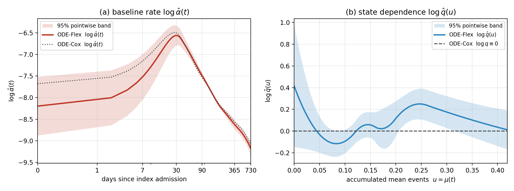

# MIMIC-III analysis (Section 6 of the paper)

This folder reproduces the real-data analysis of the paper: the recurrence of ICU
readmissions in MIMIC-III, modelled by the Cox-type model (ODE-Cox, `q ≡ 1`) and the
general model (ODE-Flex, `α` and `q` unspecified), with the likelihood ratio test of
`H0: q ≡ 1` calibrated by the parametric bootstrap.

## Data access

MIMIC-III is available only to credentialed users who have signed the PhysioNet data
use agreement (<https://physionet.org/content/mimiciii/1.4/>). For this reason the
repository contains **no patient-level data**: all intermediate files are written to
`output/`, which is excluded from version control, and `results/` contains only
aggregate results.

The scripts read two inputs from the folder given by the environment variable
`MIMIC_DIR` (default: `mimic_study/data/`, also excluded from version control):

```
$MIMIC_DIR/
├── processed-data/
│   ├── input.csv        # 26 summary statistics of the 17 SAPS-II features, first 24 h
│   └── valid_aids.csv   # HADM_ID of each row of input.csv
└── raw-data/
    └── ADMISSIONS.csv   # ADMISSIONS table of MIMIC-III v1.4
```

`input.csv` and `valid_aids.csv` are produced by the preprocessing of Purushotham et
al. (2018), <https://github.com/USC-Melady/Benchmarking_DL_MIMICIII>
(`preprocessing/steps/get_avg_17_features_raw.py`); they contain the 35,643 adult
patients alive 24 hours after their first ICU admission.

## Pipeline

```bash
export MIMIC_DIR=/path/to/mimic/data
bash run_all.sh            # or run the steps below one at a time
```

| Step | Script | Output (in `output/` unless stated) |
|---|---|---|
| 1. Cohort cleaning: first ICU admission, age cap, clinical bounds, missingness indicators | `clean_cohort.py` | `cohort_clean.csv` |
| 2. Long format with the two-year administrative window, `C = min(730 days, death)` | `build_long_format.py --horizon-days 730 --tag 2y` | `cohort_long_2y.{csv,npz}` |
| 3. Standardization (median/IQR for skewed variables, mean/SD otherwise), median imputation | `scale_features.py --tag 2y` | `cohort_long_scaled_2y.npz`, `scaler_params_2y.csv` |
| 4. ODE-Cox and ODE-Flex fits, likelihood ratio statistic, coefficient table | `fit_final_horizon.py 2y` | `final_2y.npz`, `final_2y_coef.csv` |
| 5. Resampling standard errors and pointwise bands (B = 8000, seed 1) | `resample_bands.py 2y 8000 1` | updates `final_2y.npz`, `final_2y_coef.csv` |
| 6. Parametric bootstrap of the likelihood ratio test (B = 200) | `bootstrap_final_lr.py 2y 200 10` | `final_2y_bootstrap.csv` |
| 7. Figure 5 | `plot_final_horizon.py 2y` | `results/mimic_2y_functional.png` |
| 8. Aggregate results | `export_results.py 2y` | `results/*.csv` |

On a 10-core workstation, steps 1-3 take about a minute, step 4 about 40 minutes and
step 6 about two hours.

Model specification (Section 6.2 of the paper): 20 covariates (the averages of the
maximum and minimum of each vital sign and laboratory value, single-valued variables,
comorbidities, admission-type indicators, and missingness indicators for PaO2/FiO2 and
bilirubin); quadratic B-splines for `log α` and `log q` with `⌈m^{1/7}⌉ = 5` intervals
and knots at the sample quantiles; ODE-Cox with all coefficients free and sandwich
standard errors; ODE-Flex with the BUN covariate rescaled by its ODE-Cox estimate and
`log α` fixed at its ODE-Cox value at the median readmission time, so that ODE-Cox is
nested in ODE-Flex and the likelihood ratio statistic is non-negative.

## Main results

### Regression coefficients (Table 9 of the paper)

Two-year window, 35,626 patients and 6,949 readmissions; covariates are on the
standardized scale of Section 6.1, ordered by the ODE-Cox *p*-value. Under ODE-Flex the
BUN coefficient is fixed at its ODE-Cox estimate for identifiability and has no standard
error. Significance under ODE-Cox: \* *p* < 0.05, \*\* *p* < 0.01, \*\*\* *p* < 0.001.

| Covariate | ODE-Cox EST | ESE | 95% CI | *p* | ODE-Flex EST | ESE | *p* |
|---|---:|---:|:---:|---:|---:|---:|---:|
| BUN*** | 0.2645 | 0.0153 | [0.2346, 0.2944] | <0.001 | 0.2645 | – | – |
| Bicarbonate*** | 0.1775 | 0.0185 | [0.1411, 0.2138] | <0.001 | 0.1705 | 0.0165 | <0.001 |
| Heart rate*** | 0.1299 | 0.0165 | [0.0975, 0.1622] | <0.001 | 0.1264 | 0.0176 | <0.001 |
| Bilirubin not measured*** | -0.2530 | 0.0355 | [-0.3226, -0.1834] | <0.001 | -0.2308 | 0.0442 | <0.001 |
| Urine output*** | -0.1432 | 0.0235 | [-0.1892, -0.0971] | <0.001 | -0.1381 | 0.0228 | <0.001 |
| Haematologic malignancy*** | 0.3872 | 0.0788 | [0.2328, 0.5415] | <0.001 | 0.4161 | 0.0935 | <0.001 |
| Scheduled surgical*** | -0.2743 | 0.0560 | [-0.3840, -0.1645] | <0.001 | -0.2468 | 0.0665 | <0.001 |
| WBC*** | -0.0936 | 0.0216 | [-0.1360, -0.0512] | <0.001 | -0.0961 | 0.0257 | <0.001 |
| Sodium*** | -0.0691 | 0.0179 | [-0.1042, -0.0341] | <0.001 | -0.0568 | 0.0174 | 0.001 |
| PaO2/FiO2 not measured* | 0.0826 | 0.0365 | [0.0111, 0.1541] | 0.023 | 0.0762 | 0.0411 | 0.064 |
| Systolic blood pressure* | -0.0431 | 0.0190 | [-0.0804, -0.0058] | 0.024 | -0.0402 | 0.0171 | 0.019 |
| Potassium* | 0.0379 | 0.0183 | [0.0020, 0.0737] | 0.038 | 0.0319 | 0.0164 | 0.052 |
| AIDS* | 0.3407 | 0.1736 | [0.0004, 0.6810] | 0.050 | 0.2369 | 0.0977 | 0.015 |
| Body temperature | -0.0331 | 0.0183 | [-0.0690, 0.0028] | 0.070 | -0.0293 | 0.0181 | 0.105 |
| Metastatic cancer | 0.0697 | 0.0614 | [-0.0506, 0.1900] | 0.256 | 0.0770 | 0.1069 | 0.472 |
| Age | -0.0202 | 0.0190 | [-0.0574, 0.0170] | 0.288 | -0.0294 | 0.0184 | 0.110 |
| PaO2/FiO2 | -0.0216 | 0.0378 | [-0.0957, 0.0524] | 0.567 | -0.0101 | 0.0414 | 0.807 |
| Bilirubin | 0.0040 | 0.0078 | [-0.0113, 0.0194] | 0.608 | 0.0088 | 0.0058 | 0.131 |
| GCS | -0.0062 | 0.0169 | [-0.0393, 0.0269] | 0.713 | 0.0107 | 0.0183 | 0.558 |
| Unscheduled surgical | 0.0093 | 0.0420 | [-0.0730, 0.0915] | 0.825 | -0.0194 | 0.0455 | 0.670 |

### Functional parameters (Figure 5 of the paper)



(a) Baseline readmission rate $\log\hat\alpha(t)$ under ODE-Flex with its 95% pointwise
band, and under ODE-Cox (dotted); days on a logarithmic scale. (b) $\log\hat q(u)$ under
ODE-Flex with its 95% pointwise band, where $u=\mu_i(t)$ is the expected number of previous
readmissions; the dashed line $\log q \equiv 0$ is the Cox-type model. The range shown
contains 95% of the fitted values $\hat\mu_i(C_i)$.

### Likelihood ratio test of the Cox-type model

| Statistic | Value |
|---|---|
| $\mathrm{LR} = 2m\{\ell_m(\text{ODE-Flex}) - \ell_m(\text{ODE-Cox})\}$ | 55.41 |
| Bootstrap replicates (fitted ODE-Cox null, $X_i$ and $C_i$ fixed) | 200 |
| Bootstrap null distribution: median / 99th percentile / maximum | 5.62 / 17.08 / 18.28 |
| Bootstrap *p*-value | ≤ 1/201 ≈ 0.005 |

The Cox-type model ($q \equiv 1$) is rejected. The estimated $\log\hat q(u)$ rises to about
0.25 at $u \approx 0.25$ (a readmission rate 1.28 times that of the Cox-type model), and its
band excludes zero for $0.21 \le u \le 0.32$, a range reached by about 34% of the patients.

## Result files (`results/`)

| File | Content |
|---|---|
| `coefficients_2y.csv` | Table 9: estimates, standard errors, 95% intervals and p-values under both models |
| `functional_alpha_2y.csv`, `functional_q_2y.csv` | Figure 5: `log α(t)` and `log q(u)` with pointwise standard errors |
| `lr_test_2y.csv`, `bootstrap_lr_2y.csv` | LR = 55.41; bootstrap null median 5.62, maximum 18.28; p ≤ 1/201 |
| `cohort_2y.csv` | 35,626 patients, 6,949 readmissions, spline and anchor settings |
| `scaler_params_2y.csv` | centring and scaling of each covariate |
| `mimic_2y_functional.png` | Figure 5 |
